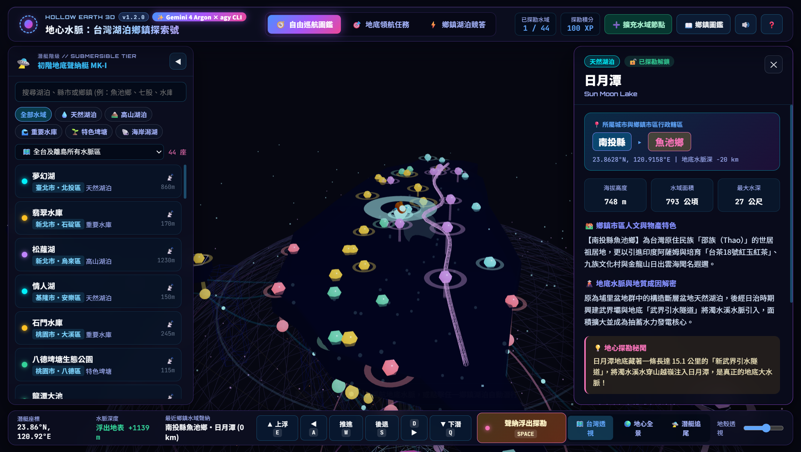
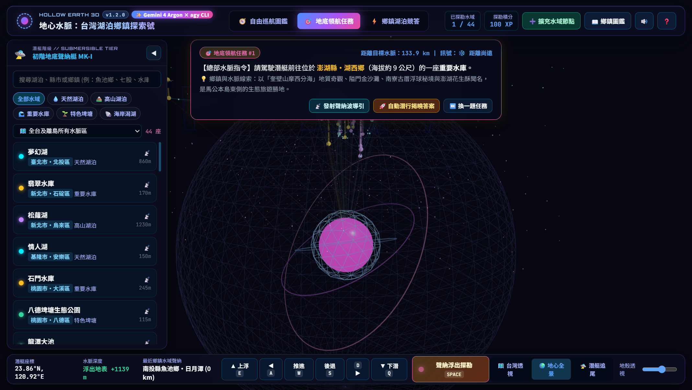
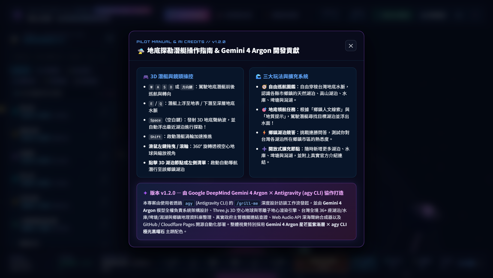
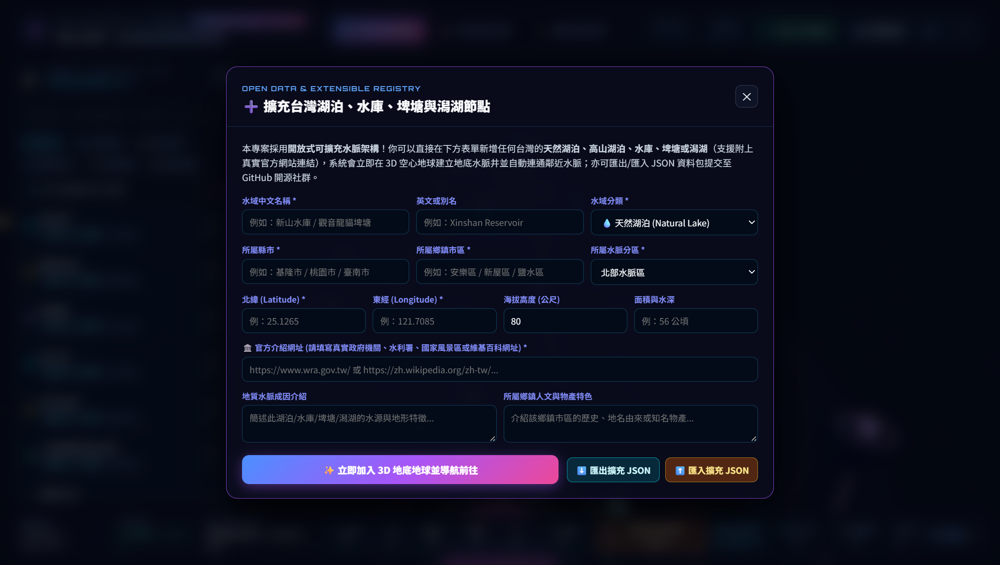

# 🛸 地心水脈：台灣湖泊與鄉鎮 3D 地底地球探索遊戲 (TERRA-AQUA TAIWAN 3D)

<p align="center">
  <a href="https://tw365-org.github.io/taiwan-hollow-earth-lakes/" target="_blank">
    
  </a>
  
  
  <a href="https://github.com/tw365-org/taiwan-hollow-earth-lakes/blob/main/LICENSE">
    
  </a>
</p>

> **🌐 線上立即體驗 (Live Demo)**：👉 **[https://tw365-org.github.io/taiwan-hollow-earth-lakes/](https://tw365-org.github.io/taiwan-hollow-earth-lakes/)**
>
> **✨ 版本與開發貢獻 (`v1.2.0`)**：本專案透過 **Antigravity (`agy` CLI)** 發起，由 Google DeepMind **Gemini 4 Argon** 模型協作完成 3D 空心地球等離子引擎、全台湖泊/水庫/埤塘/潟湖與鄉鎮地理資料庫、真實官方權威連結查證及星芒藍紫漸層介面設計。

---

## 📸 遊戲畫面預覽 (Screenshots)

### 1. 🗺️ 台灣 3D 地底水脈透視 × 鄉鎮湖泊全息資訊卡
駕駛 `Nautilus-TW` 探勘潛艇穿梭於半透明台灣地殼與中央山脈水脈脊樑，浮出湖面即可解鎖該湖泊所屬 **縣市與鄉鎮市區**（如：`南投縣 ▸ 魚池鄉` 日月潭）、地質水脈成因、地方人文物產與真實官方權威網站連結：



---

### 2. 🌍 空心地球地心熔岩全景 × 地底領航任務模式
切換至 **「🌍 地心全景」** 視角，仰望空心地球深處自轉發光的地心熔岩太陽與三軸磁力環；在 **「🎯 地底領航任務」** 模式中，根據鄉鎮人文線索與聲納距離雷達，駕駛潛艇搜尋目標湖泊：



---

### 3. ✨ 潛艇駕駛手冊 × Gemini 4 Argon & `agy` CLI 協作貢獻聲明 (`v1.2.0`)
點擊頂部 **`✨ Gemini 4 Argon × agy CLI`** 徽章或右上角 **`?`** 按鈕，即可檢視完整 3D 潛艇鍵盤操控指南、三大遊戲模式說明，以及本專案由 **Google DeepMind Gemini 4 Argon × Antigravity (`agy` CLI)** 打造的架構與配色貢獻說明：



---

### 4. ➕ 開放式可擴充水域節點管理員（支援 JSON 匯入/匯出）
內建開放式可擴充架構，點擊右上角 **「➕ 擴充水域節點」** 即可即時新增任何台灣湖泊、高山湖泊、水庫、埤塘或潟湖（含所屬縣市鄉鎮、經緯度與官方網站網址），3D 空心地球將自動建立垂直水脈井並連通鄰近地下伏流：



---

## ✨ 專案核心特色

1. **🌍 3D 透視空心地球 × 台灣立體地底水脈 (Three.js + GSAP)**
   - **地心熔岩內核與磁場環**：球體深處擁有自轉發光的地心熔岩太陽與三軸磁力環。
   - **X-Ray 半透明台灣地殼**：即時拉動滑桿調整台灣本島與離島（澎湖、蘭嶼、金門）地殼透明度，直視地底垂直水脈井與連通伏流網路。
   - **Nautilus-TW 地底探勘潛艇**：支援鍵盤 `WASD` / `方向鍵` / `E` / `Q` / `空白鍵聲納浮出` 手動巡航，或點擊任一節點啟動 3D 貝茲曲線自動導航。

2. **🏘️ 台灣全境湖泊 × 所屬城市與鄉鎮市區深度導覽**
   - 涵蓋 **💧天然湖泊、🏔️高山湖泊、🌊重要水庫、🌱特色埤塘、🐚海岸潟湖** 五大分類。
   - 每座湖泊皆詳列 **所屬縣市與鄉鎮市區**（例如：南投縣魚池鄉、新北市烏來區、臺東縣海端鄉、高雄市茂林區、臺南市七股區、桃園市龍潭區等）、海拔面積、地質成因與鄉鎮地方物產人文介紹。

3. **🏛️ 真實官方權威介紹連結（零虛構網址）**
   - 每座水域皆附帶真實可驗證之主管機關官方網站連結（經濟部水利署、各區水資源分署、台電、農田水利署、國家公園管理處、交通部觀光署各國家風景區管理處、農業部林業及自然保育署台灣山林悠遊網、各縣市政府觀光旅遊網）、維基百科地理條目與 Google 衛星地圖精確座標。

4. **➕ 開放式可擴充架構（湖泊、水庫、埤塘、潟湖皆可隨時擴充）**
   - **遊戲內即時擴充管理員**：點擊右上角 `➕ 擴充水域節點`，即可填入名稱、分類、縣市、鄉鎮市區、經緯度與官方介紹網址，3D 地球將立即生成新水脈井並自動連通鄰近地底水脈！
   - **外部 JSON 資料包擴充**：直接編輯 [`data/custom-lakes.json`](./data/custom-lakes.json) 或於遊戲中一鍵匯入/匯出 `.json` 檔案，方便開源社群透過 GitHub Pull Request 持續擴充全台各地埤塘、水庫與秘境湖泊。

5. **🎮 三大互動遊戲模式 + Web Audio 即時合成音效**
   - **🧭 自由巡航圖鑑**：無壓力探索全台水脈、收集潛艇升級徽章（`MK-I` 至 `守護神 Ω`）。
   - **🎯 地底領航任務**：根據「鄉鎮人文線索」與「地質提示」加上聲納距離雷達，駕駛潛艇尋找目標湖泊並浮出水面。
   - **⚡ 鄉鎮湖泊競答**：連勝制四選一問答，挑戰你對台灣各湖泊與所屬鄉鎮市區的熟悉度。

---

## 📂 專案目錄結構

```text
taiwan-hollow-earth-lakes/
├── index.html                  # 主遊戲介面 (Import Maps 載入 Three.js / GSAP / Canvas-Confetti)
├── assets/
│   └── screenshots/            # 遊戲實機 3D 畫面預覽截圖
├── css/
│   └── style.css               # 生物發光地底科幻 HUD 樣式表 (RWD 響應式設計)
├── js/
│   ├── main.js                 # 遊戲主控制器、三模式邏輯、UI 與擴充管理員綁定
│   ├── data/
│   │   └── taiwanLakes.js      # 內建台灣湖泊鄉鎮資料庫 + LakeRegistry 可擴充類別
│   ├── scene/
│   │   └── hollowEarthScene.js # Three.js 3D 空心地球、台灣地殼、水脈管線與潛艇物理引擎
│   └── audio/
│       └── soundEngine.js      # 純 Web Audio API 合成之深海聲納與水脈環境音效引擎
├── data/
│   └── custom-lakes.json       # 外部可擴充 JSON 資料包 (示範擴充：宜蘭大同鄉明池、金門金湖鎮太湖)
├── wrangler.toml               # Cloudflare Pages 部署設定檔
├── _headers                    # Cloudflare Pages 安全與快取標頭設定
├── LICENSE                     # MIT 開源授權條款
└── README.md                   # 專案說明文件
```

---

## 🚀 線上遊玩、本地運行與部署指南

### 1. 立即線上體驗
* **GitHub Pages 線上版**：**[https://tw365-org.github.io/taiwan-hollow-earth-lakes/](https://tw365-org.github.io/taiwan-hollow-earth-lakes/)**

### 2. 本地預覽
本專案採用 **免編譯純靜態 ES Modules 架構**，無須安裝龐大的 `node_modules` 即可直接透過任何靜態伺服器啟動：

```bash
# 使用 Python 內建伺服器
python -m http.server 8080

# 或使用 Node.js npx serve
npx serve .
```
接著打開瀏覽器訪問 `http://localhost:8080` 即可開始遊玩！

### 3. 部署至 Cloudflare Pages
1. 登入 [Cloudflare Dashboard](https://dash.cloudflare.com/) ➔ **Workers & Pages** ➔ **Create application** ➔ **Pages** ➔ **Connect to Git**。
2. 選擇 `tw365-org/taiwan-hollow-earth-lakes` 儲存庫，在 **Build settings** 中設定：
   - **Framework preset**: `None`
   - **Build command**: *(留空)*
   - **Build output directory**: `/`
3. 或使用 Wrangler CLI 一鍵部署：
   ```bash
   npx wrangler pages deploy . --project-name taiwan-hollow-earth-lakes
   ```

---

## 🛠️ 如何擴充更多湖泊、水庫、埤塘與潟湖？

你有兩種方式可以隨時擴充水域資料：

### 方法 A：在遊戲介面中直接新增並匯出 JSON
1. 點擊遊戲右上角綠色按鈕 **「➕ 擴充水域節點」**。
2. 選擇分類（`天然湖泊` / `高山湖泊` / `重要水庫` / `特色埤塘` / `海岸潟湖`），輸入縣市、鄉鎮市區、北緯東經與真實官方網站連結。
3. 點擊 **「✨ 立即加入 3D 地底地球並導航前往」** 即可即時體驗；點擊 **「⬇️ 匯出擴充 JSON」** 即可下載完整 JSON 檔案。

### 方法 B：編輯 `data/custom-lakes.json`
在 [`data/custom-lakes.json`](./data/custom-lakes.json) 的 `lakes` 陣列中加入新物件，重新整理網頁即自動載入並連通地底水脈！

---

## 📜 開源元件與致謝 (Open Source Credits)

- **[Three.js](https://threejs.org/)** (`MIT License`) — WebGL 3D 空心地球、地殼擠出建模與水脈粒子渲染
- **[GSAP (GreenSock)](https://gsap.com/)** — 潛艇平滑自動導航與運鏡動畫
- **[Canvas Confetti](https://github.com/catdad/canvas-confetti)** (`ISC License`) — 任務達成與問答連勝慶祝特效
- **Web Audio API** — 原生瀏覽器零依賴深海聲納與水脈共鳴合成器
- **開放地理與水利資料來源**：經濟部水利署、內政部國家公園署、交通部觀光署、農業部林業及自然保育署、農業部農田水利署及各縣市政府公開觀光資料。
